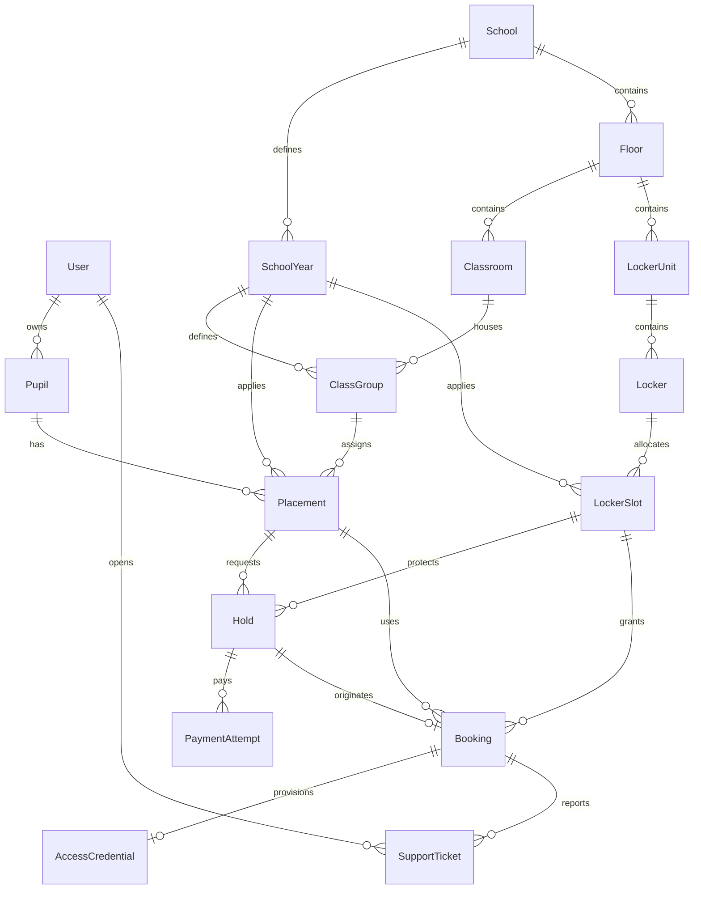

# Python booking backend: first implementation slice

Stack: Django 5.2, Django ORM/migrations, Django Ninja, django-allauth and
PostgreSQL. This is an additive backend in the existing Python package, not a
replacement React application. See the [decision](../adr/0001-django-postgresql-backend.md).

## Tables and relationships

All domain rows and guardian accounts have generated UUID primary keys.
Each model lives in its own module under
[`booking/models/`](../../backend/locker_tools/web/booking/models/).
The package's `__init__.py` re-exports the public models, so callers continue to
use `from locker_tools.web.booking.models import Locker, Pupil` without knowing
the individual module layout. Model modules import their dependencies directly.
Foreign keys use protective deletion: accidental deletion cannot cascade through
pupil, payment or booking history. A future retention workflow must explicitly
anonymise or remove records in the appropriate order.

| Table/model | Purpose and relationships | Important uniqueness |
|---|---|---|
| User | Guardian/staff identity; Django password hash; allauth email verification and sessions | Email, including case-insensitive comparison |
| School | Inventory/placement boundary; not the contracting operator | Slug |
| SchoolYear | School, named rental period, access dates, booking window, booking switch and price in cents | School + label |
| Floor | School, level, display name, optional local image path | School + level |
| Classroom | Floor and room label | Floor + label |
| ClassGroup | School year, named class and classroom | School year + class label |
| LockerUnit | Floor, cabinet number, floor-plan coordinates and dimensions | Floor + cabinet number |
| Locker | Individually bookable compartment; unit, compartment number, serviceability, optional vendor identifier | Unit + compartment |
| Pupil | Owning guardian, school, given and family names | No name-based deduplication |
| Placement | Pupil's class for one school year | Pupil + school year |
| LockerSlot | Locker's allocation identity for one school year | Locker + school year |
| Hold | Placement, slot, expiry and independent hold status | One active hold per slot and per placement |
| Booking | Placement, slot, originating hold, amount/currency and booking status | One confirmed booking per slot and per placement; originating hold |
| PaymentAttempt | Hold, provider, provider reference, amount/currency and payment outcome | Non-null provider reference |
| AccessCredential | Booking, fulfillment state, encrypted-code storage and version | Booking |
| SupportTicket | Booking, opening user, message and support state | None |



Database constraints enforce identity/claim uniqueness, non-negative money and
ordered dates. API operations check cross-school references and ownership;
foreign keys alone cannot ensure these cross-table conditions. Do not introduce
direct ORM writes, generic admin editing or import shortcuts that bypass those
rules. Booking/payment/credential tables are schema scaffolding, not a completed
fulfillment workflow, and are intentionally not editable through generic admin.

## Available Python REST interface

OpenAPI: `http://localhost:8000/api/openapi.json`; interactive docs:
`http://localhost:8000/api/docs`.

| Access | Operations |
|---|---|
| Public | `GET /api/health` (checks PostgreSQL) |
| Authenticated | `GET /api/schools`, `GET /api/inventory/{schoolId}` |
| Staff | Create schools, school years, floors, classrooms, classes, locker units and lockers through matching collection endpoints |
| Staff | `PATCH /api/school-years/{id}/booking-window` with `{"enabled": true/false}` |
| Staff | `PATCH /api/classes/{id}/classroom` with `{"classroom_id": "UUID"}` |
| Staff | `PATCH /api/lockers/{id}/condition` with `{"serviceable": true/false}` |
| Verified guardian | Create/list own pupils; create/list their school-year placements |
| Verified guardian | Create/list/release own holds; list own bookings and create/list support tickets |

Exact payloads and response schemas are in OpenAPI. Staff creates return the new
UUID. Collection reads for pupils, holds, bookings and support return
`{"items": [...], "count": N}` with `limit`/`offset` pagination. The initial inventory
snapshot rejects more than 5,000 rows in any component rather than silently
truncating. It excludes vendor identifiers and all pupil/credential data.

Guardian IDs come from the authenticated principal, never a submitted owner ID.
Unknown and other guardians' pupil/placement/hold IDs return 404. Missing login
returns 401, unverified mailbox or missing staff role returns 403, invalid
relationships return 422, and conflicting claims return 409.

This is a create/read foundation, not unrestricted CRUD. Pupil transfers,
deletion, placement changes with existing claims, subgroup eligibility and
staff recovery operations need explicit policies before endpoints are added.

### Exclusive holds

`POST /api/holds` takes `{"placement_id": "UUID", "locker_id": "UUID"}`.
It returns the hold UUID, locker/placement/year UUIDs, status and absolute expiry.
Release through `POST /api/holds/{id}/release` with an empty object.

- Selection expires exactly 30 minutes after the database-clock selection time.
  Retrying the same pupil/locker returns the existing hold without extending it.
- Acquire/release lock the school year first, then the relevant records, inside
  PostgreSQL transactions. The booking switch uses the same year lock. This
  deliberately serialises short hold operations within a year; it is a simple
  initial correctness boundary, not a realtime scaling architecture.
- Expired active rows are marked expired under that lock before a new claim.
  Read responses report an expired hold even before its stored status is updated.
  An expiry is therefore effective without an always-running cleanup job.
- A pupil must explicitly release their existing hold before selecting a different
  locker. Staff closure prevents new selections but does not revoke existing
  holds. Payment behaviour after closure is not implemented.
- An unavailable, held, booked, wrong-school or out-of-service locker is rejected.
  No websocket is required for exclusivity.
- Access dates are explicit, with an exclusive end date. The initial API rejects
  overlapping school-year access intervals as a safety guard; it does not infer
  rental dates or implement overlapping-term access.

### Authentication and agents

Use allauth's headless **browser** interface under `/_allauth/browser/v1/`:

1. `GET config` sets a CSRF cookie.
2. `POST auth/signup` with `email` and `password` creates an unverified account
   and sends an email. The resulting 401 indicates verification is still needed.
3. `POST auth/email/verify` with `key` completes mailbox verification; its 401
   response indicates that login is still required. Confirmation does not
   automatically authenticate the account.
4. `POST auth/login` authenticates with email/password.
5. `POST auth/password/request` sends a reset email; `POST auth/password/reset`
   takes the reset `key` and new `password`.
6. `DELETE auth/session` logs out.

Retain cookies and send the `csrftoken` value as `X-CSRFToken` on unsafe requests
to both APIs. Login rotates the CSRF token, so use the latest cookie. Scripts and
agents can use the same verified-account session flow; scoped machine tokens,
delegation and independently audited agent permissions are not implemented.
Email verification proves control of a mailbox, not guardianship.

Development email is captured in Mailpit at `http://localhost:8025`; it is not
sent to actual families. Verification/reset emails point at frontend paths that
React has **not yet implemented**. The backend lifecycle can be exercised by
extracting the key from the email and submitting it to the headless endpoint.
Do not present these unfinished links as a completed parent-facing UX.

## Local startup and validation

From the workspace or repository root:

```sh
just up
```

This preserves the existing React/Express/MySQL services on port 3000 and adds
Python on 8000, private PostgreSQL, and the local email inbox on 8025. Dependencies
are installed in the Python image; initial migrations run before the development
server starts. PostgreSQL has a separate persistent volume. No MySQL data is
copied, deleted or interpreted as PostgreSQL inventory.

`just env` creates missing local configuration and generates a development Django
secret without replacing existing secrets; it does not print values. Keep the
existing PostgreSQL password stable once the volume exists. The template's
`change-me` PostgreSQL password is development-only. Do not reuse it in production.
Startup reads the Django secret from the refreshed local file, not an outdated
value loaded into `just` before the environment recipe ran.

From the **repository root**:

```sh
just createsuperuser  # Interactive staff account, no default credentials
just migrate
just test            # Existing Python tests plus real PostgreSQL API/concurrency tests
just test-pg         # Only PostgreSQL-backed web tests
just test-tools      # Existing 43 importer/assignment tests, no database required
just down            # Stops services; keeps database volumes
```

The backend image includes tests and dev dependencies for local validation.
Re-run `just up` after changing Python code: this initial image does not bind-mount
the host package/virtualenv. No synthetic inventory is seeded automatically.
Create staff-managed reference data through the Python API before adding pupils.

For host-side targeted tests, set `POSTGRES_HOST`, `POSTGRES_PORT`, `POSTGRES_USER`,
`POSTGRES_DB` and `POSTGRES_PASSWORD` to a disposable PostgreSQL instance and run
`uv run pytest tests/web` in the backend directory. Tests use a separate Django
test database; concurrency acceptance must not substitute SQLite. Test settings
use an in-memory email backend and test-only configuration, never production
credentials.

## Explicitly not finished

- React persistence and a migration/import bridge from legacy MySQL inventory.
  Legacy form data still stays in React context and legacy reservations still
  use their old 15-minute logic. The new 30-minute API is not wired into that UI.
- SumUp checkout/webhooks, price snapshots at checkout, refunds, late-payment
  recovery and a paid booking confirmation service. There is no create-booking
  endpoint and no client-supplied `paid` flag. New booking rows default to pending.
- Code provisioning/rotation/reveal, encrypted credential writes, master-code
  management and connection to the existing Express RAS simulator.
- Staff support workflow, WhatsApp delivery, access revocation and retention.
- Production hosting/DSGVO approval, AVV, TLS/proxy settings, SMTP delivery,
  least-privilege runtime database roles, encrypted disks/backups and restore
  testing. Names/email are **not field-encrypted** by this implementation.
  `encrypted_code` is only a future storage field, not an encryption service.

Compose runs Django's development server with debug enabled and a PostgreSQL
initialisation user; this is **not** a production deployment. Runserver, Mailpit,
test settings, debug mode and the local database password must not be shipped
as production configuration.

Issue [#46](https://github.com/rrahn/spind/issues/46) remains open: PostgreSQL
lockers now have UUIDs, but legacy UUID backfill and consumer migration are still
outstanding.
